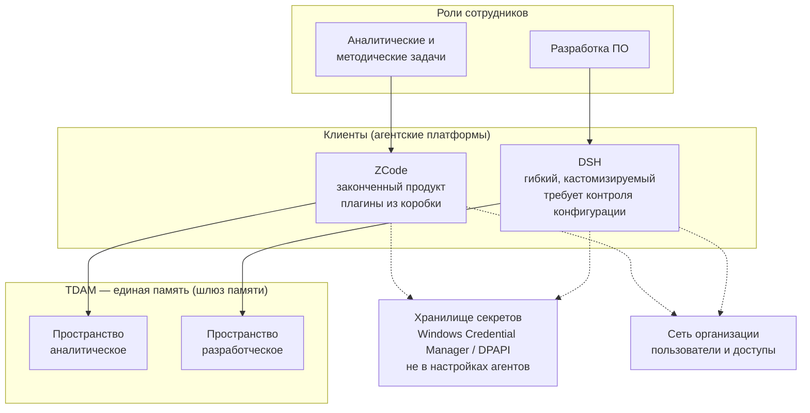

# Основы агентской инфраструктуры

> **Статус:** основополагающий документ. Принят 04.11.2026.
> **Назначение:** зафиксировать базовые принципы построения системы, чтобы
> **больше к ним не возвращаться** — только дополнять их далее.
>
> Этот файл стоит над остальными документами. Планы, стандарты и адаптеры
> выводятся из него. При расхождении любого документа с этим — верен этот
> документ.

---

## 1. Главный принцип: инфраструктура — рабочий инструмент, не полигон

Агентская инфраструктура — это **не исследовательская площадка для
изучения агентов**. Это **рабочий инструмент для исполнения основных
обязанностей команды**. Агенты в нём — новый и более мощный инструмент, но
инструмент, а не самоцель.

**Следствие — изначальное требование шаблонизации.** Инфраструктура
проектируется как максимально шаблонная с самого начала. Изучение агентов —
не отдельная задача «на потом», а побочный продукт работы: разбираемся
по мере применения.

## 2. Принцип готовности: работает — применяется сразу

Разделение по стадиям:

| Стадия | Что с этим делать |
|---|---|
| **Уже работает** | применяется **сразу** в рабочих процессах |
| **В разработке** (изучаем, дорабатываем) | применяется **по ходу готовности** |
| Освоено | применяется **сразу и для всех** |

Ключевая часть: то, что доведено до готовности, внедряется **сразу для
всех**, а не ждёт «полного внедрения». Отсюда же — почему единая память
(TDAM), а не per-agent движки: одно готовое решение применяется всем сразу.

## 3. Принцип единой точки: сокращение инвариантов ошибок

Всё, что увеличивает число точек администрирования или разнообразие
протоколов, — **отклоняется**. Всё, что унифицирует, — **приоритетно**.

**Обоснование — типизация ошибок.** Общая система для всех даёт:

- **общую номенклатуру проблем** — ошибки становятся классами, а не случаями;
- **единый протокол** у однотипных агентов;
- **одно исправление на всех** — фикс у одного агента исправляет у всех;
- **общее обновление** — касается всей инфраструктуры сразу.

Per-agent решения (свой движок у каждого агента) дают **уникальные ошибки
в каждой точке**. Уникальные ошибки невозможно шаблонизировать, и разбор
каждой съедает время, которое должно идти на основные обязанности.

**Формулировка заказчика:** система не избавляет от ошибок работы с ней,
но даёт их **типизацию и шаблонизацию** — за счёт того, что она общая.

## 3.1. Принцип кубика: система собирается из проверенных компонентов

**Общий принцип композиции** — применим и к построению инфраструктуры, и к
разработке пайплайнов, и к любым другим разработкам.

**Формулировка.** Любая сложная система собирается из **отдельных проверенных
работающих кубиков**. Сложность системы определяется **лишь количеством таких
кубиков** — не связностью, не хитростью отдельных частей. Кубик — это
компонент, который решает **свою** задачу, легко предсказуем и строго
функционален.

**Зачем это нужно — диагностика.** Локализация проблем облегчается именно
за счёт предсказуемости кубиков: если каждый кубик строго функционален и
предсказуем, то при сбое ясно, **какой** кубик отказал и **почему**. Проблема
не размазывается по всей системе, а локализуется в одной точке с известным
поведением.

**Следствия:**

1. **Собираем из готового проверенного.** Новый кубик ставится рядом с
   работающими, а не вплетается в них. Работающее не переделывается ради
   нового.
2. **Кубик проверяем отдельно.** Тест кубика не требует всей системы —
   он изолирован (ср. регресс-тест в §1.1 проектного видения).
3. **Рост системы — это рост числа кубиков**, а не усложнение связей.
   Десять простых кубиков лучше одного сложного, решающего десять задач.
4. **Диагностика через границы.** Сбой локализуется по границе кубика:
   если вход верный, а выход неверный — виноват этот кубик, и только он.

**Связь с узким определением.** В проектном документе «кубик» определён уже:
**детерминированное — в код, суждение — модели**, где кубик противопоставлен
суждению. Это **частный случай** данного принципа: там речь о том, что
детерминированный компонент надёжнее поручения модели. Здесь — **общий принцип
композиции**, который этим не ограничивается: кубик может быть и агентом,
и сервисом, и правилом, если он предсказуем, строго функционален и
проверяем отдельно.

**Практический тест.** При добавлении чего-либо в систему:

- это **отдельный кубик** (своя задача, свой вход/выход, отдельная
  проверка) или вплетается в существующий?
- можно ли проверить его **отдельно** от остальных?
- если он сломается, **ясно ли**, что сломалось и почему?

Если на все три вопроса ответ «нет» — это не кубик, а усложнение связей.
Такой элемент отклоняется или переразбивается на кубики.

## 3.2. Разделение платформ по ролям: ZCode и DSH

Клиенты в инфраструктуре **не взаимозаменяемы** — у каждого своя роль. Это
разделение ролей, а не дублирование инструментов.

| | **ZCode** | **DSH** |
|---|---|---|
| **Для кого** | роль: аналитические и методические задачи | роль: разработка ПО |
| **Какие задачи** | работа с данными: из учётных систем, текстовые данные управленческих и производственных регламентов и т.п. | сопровождение учётных систем, разработка ПО для автоматизации |
| **Характер продукта** | **законченный продукт** — широкая функциональность из коробки | **гибкий и кастомизируемый** — адаптируется под особенности разработки |
| **Плагины** | широкая номенклатура встроенных — именно под офисную работу | гибкость настраивается под нужды разработки |
| **Цена гибкости** | — | требует более пристального контроля конфигурации и настройки; посильно команде разработчиков |

### Почему именно так

**ZCode** — законченный продукт с широкой номенклатурой встроенных плагинов,
которые требуются именно для офисной работы. Для аналитических и
методических задач это ровно то, что нужно: готовый инструмент, не
требующий настройки под каждую задачу.

**DSH** — более гибкий и кастомизируемый продукт. Его гибкость позволяет
адаптировать его под особенности разработки ПО; но **та же гибкость для
офисного применения требует больших затрат и усилий** — именно из-за
возможностей гибкой переконфигурации. Поэтому DSH закрепляется за командой
разработчиков: там гибкость востребована, и там есть ресурс на пристальный
контроль его конфигурации.

**Практический вывод (из §1 — рабочий инструмент, не полигон):** не тащить
ZCode туда, где нужна глубокая кастомизация, и не тащить DSH в офисную
работу, где достаточно готового продукта. Каждая платформа — в своей роли.

### Следствия для инфраструктуры (что предстоит проработать)

**Это не вывод из наблюдений, а часть задумки.** Разделение платформ по
ролям **сознательно** влечёт эти три вопроса: инфраструктура строится и
разворачивается с учётом того, что при переходе к сетевым рабочим местам
(разные компьютеры, отдельный сервер под память) понадобятся разделение
памяти, связь с сетью и вынос секретов из локальных настроек. Пункты
ниже — намеченные заранее шаги, а не обнаруженные побочно.

Пока **не решены** — составят отдельную работу при углублении
инфраструктуры:

1. **Разделение пространства памяти TDAM** на аналитические и
   разработческие пространства (у v3 API есть триплет team/agent/user —
   вероятный механизм).
2. **Связь пользователей-агентов с сетевой инфраструктурой**
   (кто есть кто, откуда доступ).
3. **Механизмы хранения секретов пользователей** — не в настройках
   локальных агентов, а через Windows Credential Manager либо DPAPI
   (Data Protection API) или их аналоги в Linux.

Эти три пункта — предмет будущего углубления; здесь они зафиксированы,
чтобы не потерять.

### Диаграмма

## 4. Что из этого следует практически

1. **Одна память на всех** — TDAM. Per-agent движки отключаются
   (решение по engram, 04.11.2026).
2. **Один стандарт дисциплины** — `стандарт-работы-с-памятью.md`.
3. **Адаптеры тонкие и шаблонные** — различие только в доступе, дисциплина
   общая. Чем тоньше адаптер, тем меньше в нём уникальных ошибок.
4. **Подключение нового агента — по шаблону**, а не по-своему каждый раз.
5. **Единый канал доступа** — где возможно, один протокол (HTTP v3 API
   шлюза), а не N разных.
6. **Ошибки типизируются** — каталог типовых проблем с лечениями
   (Этап 5 плана доработки TDAM).
7. **Система растёт кубиками** — сложность = число проверенных компонентов,
   а не связность (см. §3.1).
8. **Платформа — под роль** (см. §3.2): ZCode для аналитики и методики,
   DSH для разработки; не взаимозаменяемы.

## 5. Границы принципа

Принцип не означает «всё делать одной программой». Он означает:

- **допустимо** — разные клиенты (ZCode, DSH) с тонкими адаптерами;
- **недопустимо** — разные **системы памяти**, разные **протоколы
  дисциплины**, разные **точки администрирования** там, где достаточно
  одной.

Различие клиентов — неизбежно (они разные по природе). Различие
инфраструктуры — выбор, и его делаем в пользу единства.

## 6. Как этим пользоваться

- **Перед решением** «взять инструмент X»: не увеличит ли он число точек
  администрирования или протоколов? Если да — отклонить или отложить.
- **Перед решением** «сделать под конкретный случай»: можно ли сделать
  шаблонно и применить всем? Если да — делать шаблонно.
- **При появлении проблемы**: это типовая проблема (лечим один раз для
  всех) или уникальная (значит, мы где-то разошлись с шаблоном — чиним
  причину расхождения, а не симптом).

## 7. Источник замысла — видение заказчика, не вывод агента

**Инфраструктура строится по задумке заказчика.** Он видит, куда она
разворачивается, и закладывает нужные качества **заранее** — а не
обнаруживает их по мере движения. Агент оформляет замысел, проверяет его
фактами и фиксирует, но **не присваивает себе авторство связей**.

**Почему это важно фиксировать отдельно.** Если записать план как «вывод
из наблюдений» («вот что складывается»), теряется источник: будущий агент
решит, что так вышло само, и не свяжет пункты с замыслом. Тогда при
изменении обстоятельств он не поймёт, что можно менять, а что —
намеренная часть задумки.

**Практическое правило при оформлении документов:**

- то, что **заказчик сформулировал как замысел**, помечать как замысел
  заказчика, а не как вывод из данных;
- то, что агент **вывел сам** (проверка факта, найденная причина), —
  помечать как вывод агента с указанием, на чём основан;
- при записи **следствий** различать: это **намеченные заранее шаги**
  (замысел) или **обнаруженные побочно** (вывод).

Заказчик тоже учится и думает — видение инфраструктуры это плод его
опыта, а не результат перебора вариантов. Уважение к источнику — часть
переносимости знания: артефакт ценен, если видно, **чья** это мысль.

---

## История

- **04.11.2026** — документ создан. Повод: сформулирован основополагающий
  принцип (инфраструктура — рабочий инструмент, не полигон; шаблонизация
  изначальна; готовое применяется сразу и для всех) и запрошено
  зафиксировать его отдельным файлом в git, чтобы **больше не возвращаться
  к основным принципам построения системы, а лишь дополнять их далее**.
  Этот документ — тот самый слой основ.
- **04.11.2026** — добавлен §3.1 «Принцип кубика: система собирается из
  проверенных компонентов». Общий принцип композиции: любая сложная система
  собирается из отдельных проверенных работающих кубиков; сложность
  определяется количеством кубиков, а диагностика облегчается их
  предсказуемостью и строгой функциональностью. Применим и к построению
  инфраструктуры, и к разработке пайплайнов. Дополняет узкое проектное
  определение «кубик = детерминированное в код» как его частный случай.
- **04.11.2026** — добавлен §3.2 «Разделение платформ по ролям: ZCode
  и DSH»: платформы не взаимозаменяемы, у каждой своя роль; ZCode —
  аналитика и методика, DSH — разработка ПО. Добавлена mermaid-диаграмма
  связей.
- **04.11.2026** — добавлен §7 «Источник замысла — видение заказчика, не
  вывод агента». Повод: три следствия из §3.2 были оформлены как
  «складывающиеся» (обнаруженные побочно), тогда как они заложены заранее
  как часть задумки развёртывания. Правило: различать замысел заказчика
  и вывод агента, не присваивать авторство связей, помечать источник.
